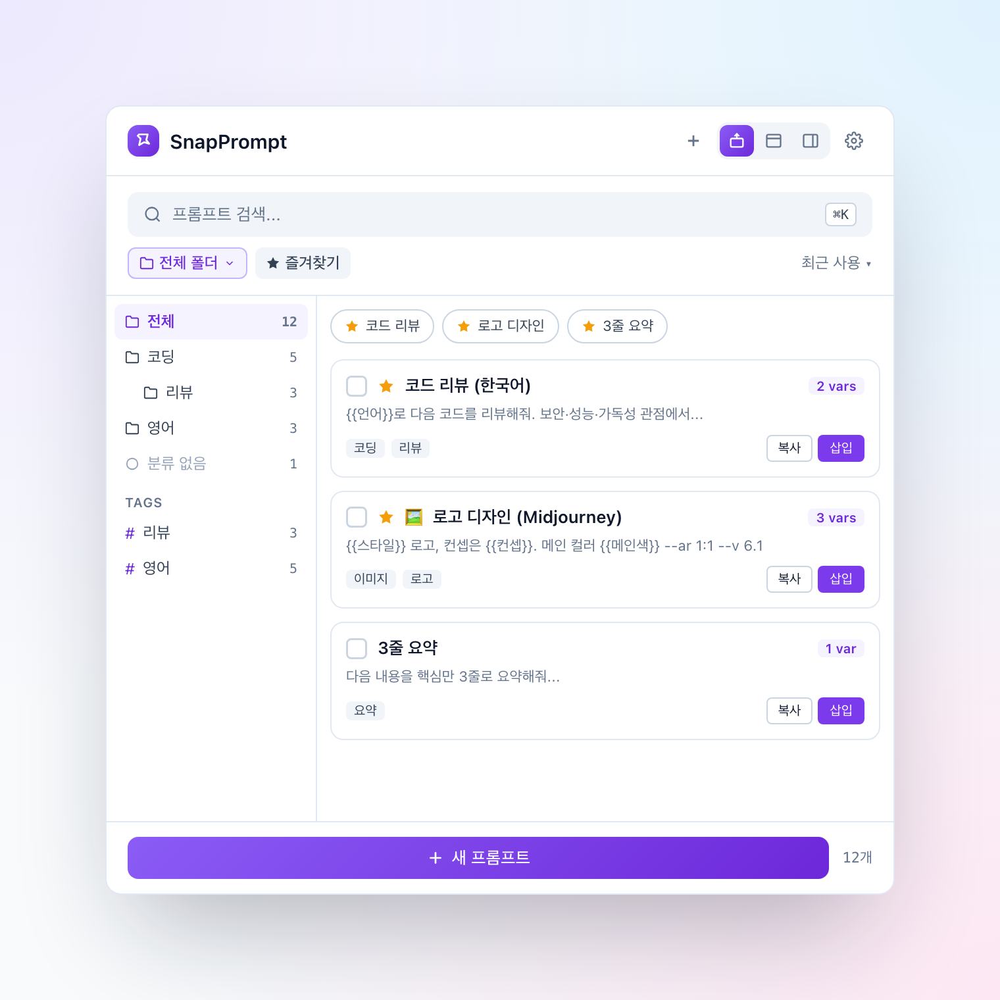
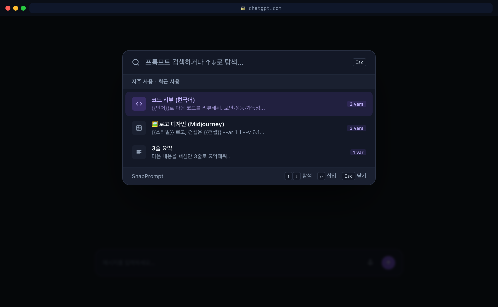
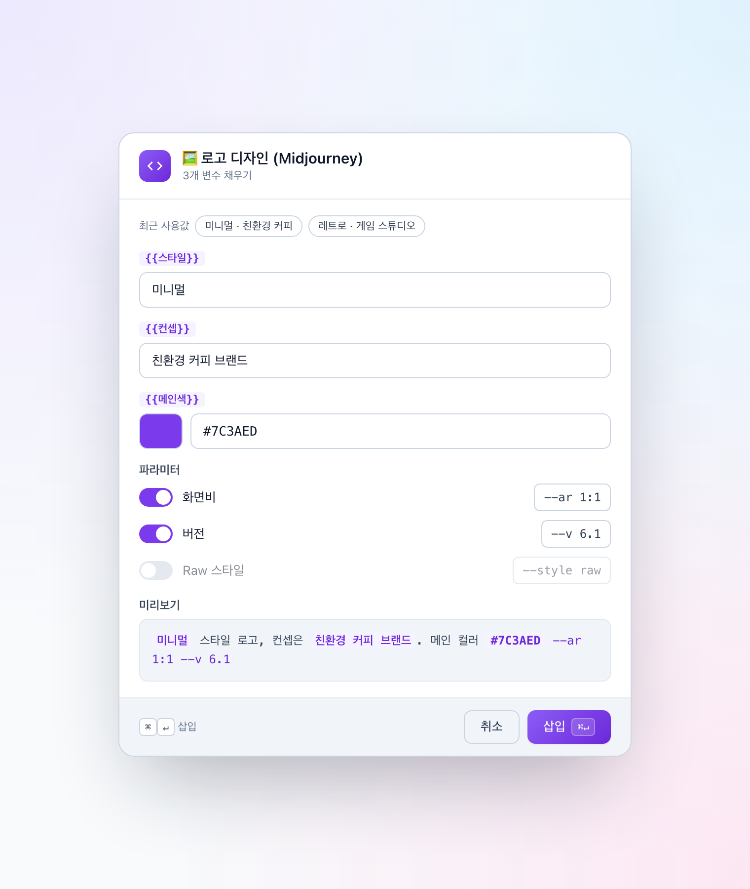
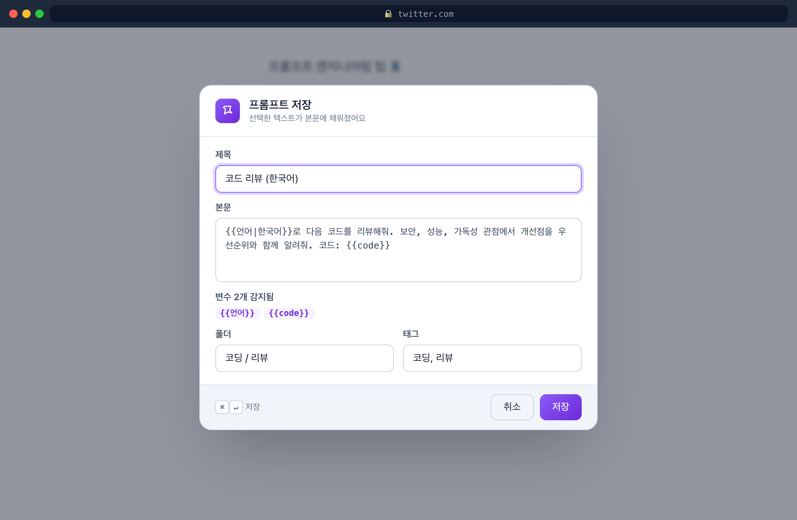
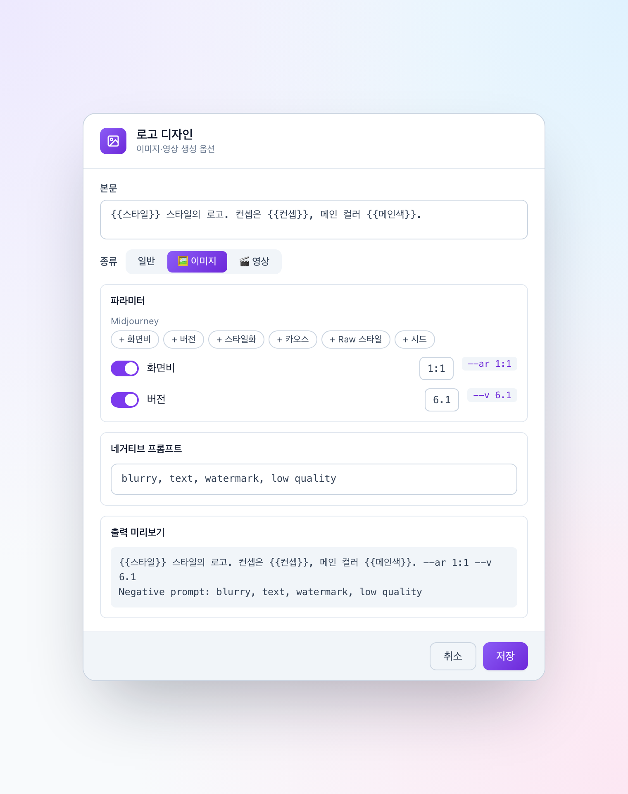
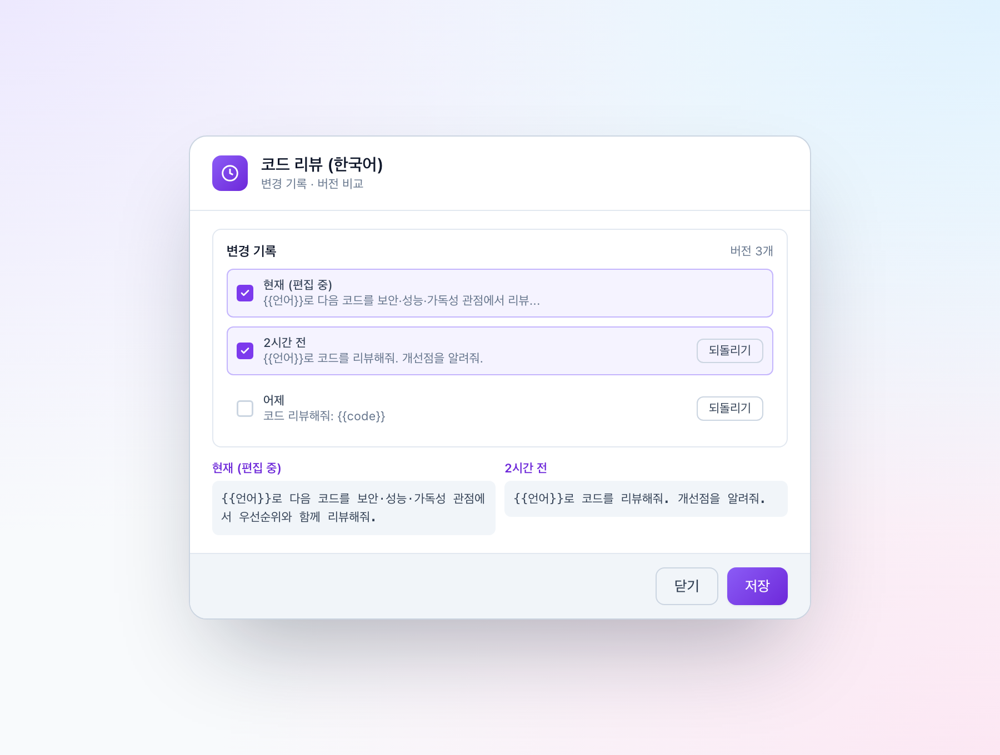
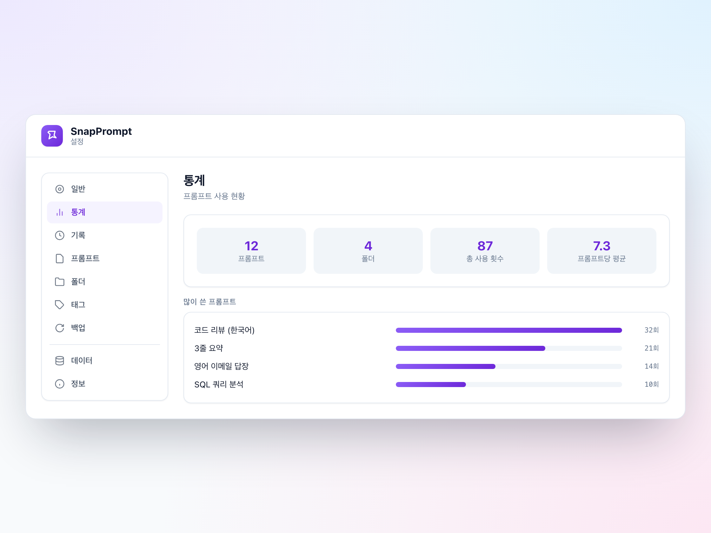
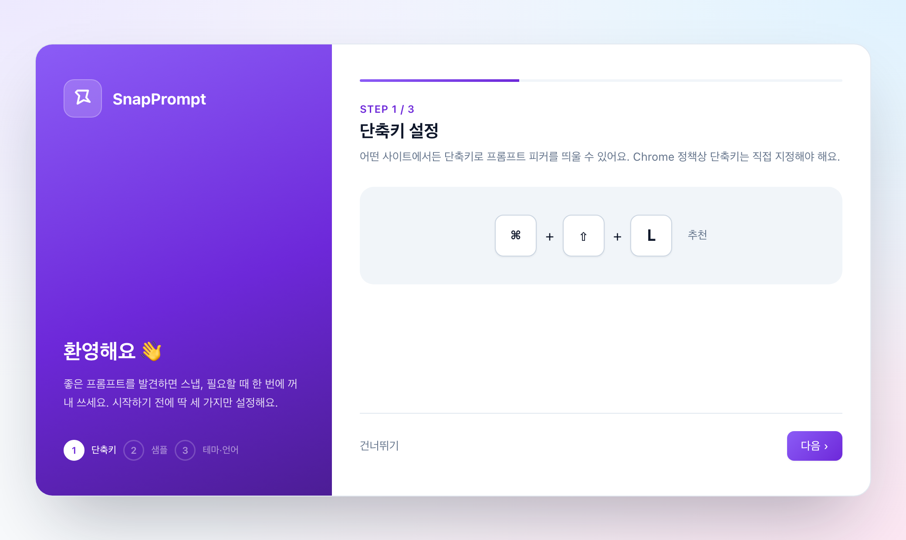

<div align="center">

# SnapPrompt

**웹서핑 중 발견한 LLM 프롬프트를 빠르게 저장하고("Snap"), 어디서든 단축키 한 번으로 꺼내 쓰는 Chrome 익스텐션.**



</div>

---

## 왜?

좋은 프롬프트를 발견해도 메모장·노션·북마크에 흩어져 저장되고, 막상 쓸 땐 다시 찾아 변수 부분을 일일이 고쳐 붙여넣어야 합니다. SnapPrompt는 **저장도 꺼내쓰기도 한 번의 동작**으로 끝냅니다.

- **저장** — 웹에서 텍스트 선택 → 우클릭 또는 단축키 → 제목·폴더·태그와 함께 저장
- **꺼내쓰기** — 어떤 입력창에서든 단축키 → 검색 피커 → 현재 입력창에 자동 삽입
- **변수** — `{{변수}}` 템플릿을 모달 폼으로 채워 완성된 프롬프트 삽입
- **이미지·영상** — Midjourney·Pika 파라미터 토글, 네거티브 프롬프트, 레퍼런스 이미지 (사진/영상/이미지 생성용)
- **반복·기록** — 편집 버전 히스토리·되돌리기·A/B 비교, 삽입 기록과 최근 사용값 재사용
- **로컬 우선** — 모든 데이터는 브라우저에 저장, 외부 서버 없음 · JSON 백업 지원

---

## 주요 기능

### 🔍 어디서든 단축키로 꺼내쓰기
ChatGPT·Claude·Gemini를 포함한 모든 입력창에서 Spotlight 스타일 피커를 띄워 검색하고, 선택하면 현재 입력창에 바로 삽입됩니다.



### 🧩 변수 템플릿 (8가지 타입 + 조건부 블록)
`{{name}}` · `{{name|기본값}}` 부터 드롭다운·날짜·숫자·컬러 피커·토글·코드 블록까지. 꺼내 쓸 때 폼으로 채우면 **실시간 미리보기**로 결과를 확인하고, **최근 사용값**을 한 번에 다시 채울 수 있어요. 이미지/영상 프롬프트라면 파라미터 토글도 같이 표시됩니다.



| 문법 | 입력 |
| --- | --- |
| `{{name}}` | 텍스트 |
| `{{name\|기본값}}` | 텍스트 + 기본값 |
| `{{name:textarea}}` | 여러 줄 |
| `{{name:number}}` | 숫자 |
| `{{name:date}}` | 날짜 |
| `{{name:color}}` | 컬러 피커 |
| `{{name:select(a,b,c)}}` | 드롭다운 |
| `{{name:boolean}}` | 토글 |
| `{{name:code(lang)}}` | 코드 블록(```` ``` ````로 감쌈) |
| `{{#if name}}…{{/if}}` | 조건부 블록 |

### 💾 빠른 저장 + 중복 감지
웹페이지에서 선택 → 우클릭으로 저장. 본문에서 변수를 자동 추출하고, 비슷한 프롬프트가 이미 있으면 경고합니다.



### 🖼 이미지·영상 생성 옵션
프롬프트 종류를 **이미지/영상**으로 지정하면 생성 도구에 맞는 옵션이 열려요. **파라미터 토글**(Midjourney `--ar`·`--v`… / Pika `-ar`·`-motion`·`-camera`…)을 프리셋에서 추가하고, **네거티브 프롬프트**와 **레퍼런스 이미지**를 더하면 `[레퍼런스] [본문] [--파라미터] [네거티브]` 순서로 조립됩니다. 삽입할 때 파라미터를 그때그때 켜고 끌 수 있어요.



### 🕘 버전 히스토리 · A/B 비교 · 사용 기록
프롬프트를 고칠 때마다 **직전 버전이 자동 저장**되어 언제든 되돌릴 수 있고, 두 버전(또는 현재 편집본)을 골라 **나란히 비교**할 수 있어요. 삽입·복사 기록은 옵션의 **"기록" 탭**에 남고, 변수 모달의 **최근 사용값** 칩으로 다시 꺼내 씁니다.



### 🗂️ 폴더 계층 · 태그 · 드래그앤드롭
무제한 깊이의 폴더 트리와 태그로 분류하고, 팝업에서 카드를 드래그해 폴더로 옮길 수 있어요 (다중 선택 지원).

### ⚙️ 설정 · 통계 · 기록 · 백업
테마(라이트/다크)·언어(한/영)·플로팅 버튼·사이트별 비활성화. 사용 통계 대시보드, 삽입 **기록** 탭, JSON 백업/복원과 자동 스냅샷까지.



### 🪟 3가지 사용 형태 (마지막 모드 기억)
- **툴바 팝업** — 기본
- **분리된 창** — 자유롭게 이동·리사이즈, 상주
- **사이드 패널** — 브라우저 옆에 도킹해 연속 삽입

마지막으로 사용한 형태를 기억해, 다음에 아이콘을 누르면 그 형태로 바로 열립니다.

### 🚀 첫 설치 온보딩


---

## 설치 (개발자용)

```bash
npm install
npm run build      # 타입체크 + 프로덕션 빌드 → dist/
```

1. `chrome://extensions` 접속 → 우측 상단 **개발자 모드** 켜기
2. **압축해제된 확장 프로그램을 로드** → `dist/` 폴더 선택
3. 설치되면 온보딩 탭이 자동으로 열립니다
4. `chrome://extensions/shortcuts`에서 **"프롬프트 피커 열기"** 단축키 지정 (예: ⌘⇧L)

### 개발 모드 (HMR)
```bash
npm run dev        # Vite 개발 서버 → dist/ 가 HMR 연결됨
```

---

## 기술 스택

- **TypeScript** + **Vite** + **Preact** + **@preact/signals**
- **@crxjs/vite-plugin** — Manifest V3 빌드
- **Fuse.js** — 퍼지 검색
- `chrome.storage.local` (+ `unlimitedStorage`)
- 커스텀 i18n 런타임 (ko/en, 런타임 언어 전환)

## 프로젝트 구조

```
src/
├─ background/   서비스 워커 — 컨텍스트 메뉴, 단축키, 메시지 허브, 액션 모드, 삽입 로그, 스냅샷·자동 백업
├─ content/      콘텐츠 스크립트 — Shadow DOM 피커·저장·변수/파라미터 모달, 삽입 호환 레이어, 플로팅 버튼
├─ popup/        팝업 — 검색·폴더 사이드바·핀 바·DnD·인플레이스 편집·마크다운 미리보기·모드 전환
├─ options/      설정 10탭 — 일반·통계·기록·프롬프트·폴더·태그·백업·단축키·데이터·정보 + 온보딩
├─ components/   공유 컴포넌트 — PromptOptionsEditor(이미지/영상 옵션) · PromptHistory(버전·비교)
├─ shared/       types · store · variables · assemble · imageparams · folders · search · backup · markdown · theme · i18n · messaging
└─ assets/icons/ 생성된 아이콘 (scripts/generate-icons.mjs)
```

## 문서

- 제품 요구사항: [docs/PRD.md](docs/PRD.md)
- 디자인 목업: [design/index.html](design/index.html)

---

<div align="center">
<sub>로컬 우선 · 외부 서버 없음 · 데이터 소유권은 사용자에게</sub>
</div>
